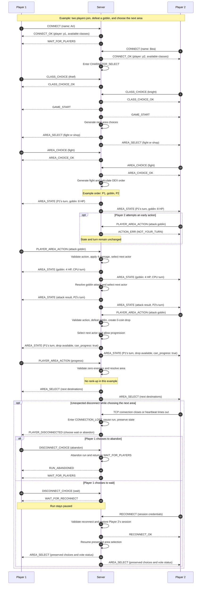

# Concurrency Design

## Concurrency Model Selection: Non-Blocking I/O Multiplexing
For this project, I feel that Non-Blocking I/O would make the most sense to implement for this project. Since this game is turn based for both players and the server (who is also a "player" in this case), I/O multiplexing lets the server handle multiple clients without dedicating a thread to each one.

### Initializing/Accepting a new client socket
At first initialization, the server program will listen to all addresses coming in on a certain port (lets use 61616 for an example). It will bind to 0.0.0.0:61616 and be set to listen and to not block, so incoming connections can be accepted as they arrive.

#### Example:
```python
HOST = "0.0.0.0"
PORT = 9003

server = socket.socket(socket.AF_INET, socket.SOCK_STREAM)
server.bind((HOST, PORT))
server.listen()
server.setblocking(False)

inputs = [server]
outputs = []
message_queues = {}

players = []

while inputs:
    for s in readable:
        if s is server:
            conn, addr = server.accept()
            conn.setblocking(False)
            inputs.append(conn)
            message_queues[conn] = []
```

### Client Registration
To further differentiate client connections to the server, each client will have a unique player name and ID. A Player object will be created server-side with all the data needed to hold a player's state.

### Game loop servicing
The game as stated before will be turn-based. That being said, player and server moves will always be sequential. However, this does not stop the clients themselves from sending messages when it's not their turn; the server will just validate and reject anything that is out of order.

### Client Teardown
If a client leaves gracefully, their associated socket will be removed from the monitored sockets, and closed for any future messages. This event will happen when the socket is readable with the appropriate disconnect signal.

## Thread Safety
Because this game is cooperative and the need for hiding intent is not needed, no data will be hidden from either client during this game. Both will share the Level number, level state (enemies, events, rewards), and turn order.

## Sequence Diagram


